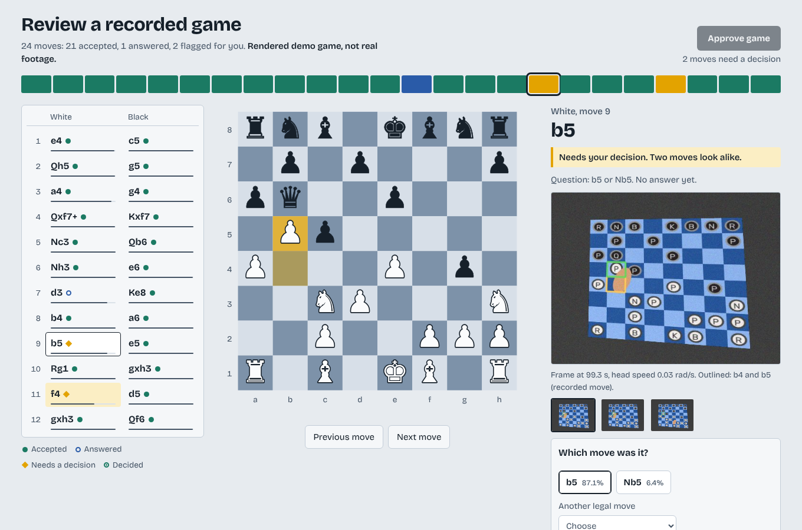
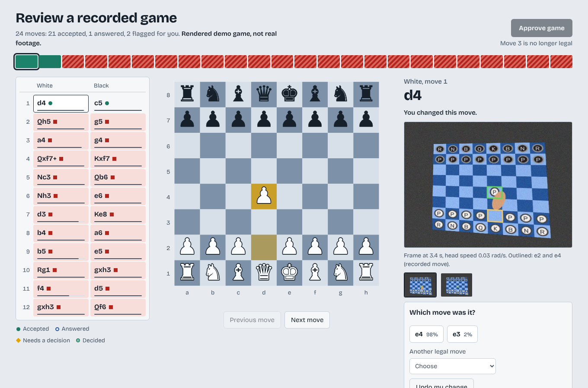

# BoardScribe

BoardScribe turns a first-person video of a chess game into a move record, checks the record with a chess rules engine, and asks the player only when the video is not enough.

Designed by Eunbi Cho. Implemented with an AI coding agent (Claude Code). Python for the pipeline, React and TypeScript for the review screen.



## What is real and what is not

| | Status |
|---|---|
| Frame selection from IMU head speed and image sharpness | Implemented and tested |
| Board corners to 64 flat squares (homography) | Implemented and tested |
| Square model fitted on the starting position, no pretrained weights | Implemented and tested |
| Scoring every legal move, asking at most once per move, rules-engine replay | Implemented and tested |
| Review screen with chain-of-trust check, PGN and `approved.json` export | Implemented and tested |
| Decoding a real `.mp4` with an IMU CSV (`boardscribe run`) | Implemented, tested on a rendered `.mp4` only |
| Board finder | Stand-in. A saturation threshold plus a quadrilateral fit. It works on the rendered boards and will not work on most real tables |
| Real footage, real boards, real glasses | **Not tested.** Every number below comes from rendered games |
| Any Meta model or API | **Not used** |

The rendered games (`boardscribe/synth.py`) have a tilted board, five color families, a head that shakes (the IMU shows it and the frame is motion-blurred), a hand that carries each piece across the board and covers squares, a lighting gradient and sensor noise. They have no real pieces, reflections or cameras. Results on them show that the pipeline logic works. They do not show that it works on a table.

## How it works

1. **Frame selection** (`frames.py`). For each move, list the frames in a time window whose IMU head speed is under a limit, without decoding anything. Decode only those, keep the sharpest by variance of the Laplacian, and keep them apart in time. If no frame is steady, use the calmest one and flag the move.
2. **Board to squares** (`grid.py`). Four corners give a homography. Each frame becomes a top-down board cut into 64 squares. Frames whose board quad jumps too far from the last one are dropped, which removes locator errors caused by a hand.
3. **Square model** (`squares.py`). The starting position is known, so the first stable frame labels all 64 squares as empty, white or black. A diagonal Gaussian per class and square color is fitted on those labels, so it is fitted to this board and this lighting. The likelihood is a narrow core, a wide tail and a uniform part, so a covered square gives a flat answer instead of a confident wrong one.
4. **Move inference** (`infer.py`). The next move is one of the legal moves from the known position. Each legal move predicts which squares are empty, white and black, and is scored against the per-frame, per-square log-probabilities (clipped, then averaged over frames). Below 90% posterior, or when the board does not match the record, the player is asked. At most one question per move. Promotions are always asked, because occupancy cannot show which piece was chosen.
5. **Rules as checker** (`verify.py`, and chess.js in the UI). Every record is replayed through the rules. Correcting one move reports the first later move it makes illegal.

```
video + IMU + "move done" times
  -> frames.select_frames
  -> grid (corners, homography, 64 squares)
  -> squares (model fitted on the starting position)
  -> infer (score legal moves, ask if unsure)
  -> record.json  -> review UI  -> approved.json -> PGN
```

## Results

20 rendered games, 30 moves each, seeds 100 to 119. Run `boardscribe benchmark --games 20 --plies 30 --workers 2` to reproduce (about 3 minutes). Full output is in `docs/benchmark.txt` and `docs/benchmark.json`.

"Selected frames" is the pipeline. "Nearest frames" takes the 3 frames closest to each move, with no IMU gate and no sharpness ranking. A simulated user answers every question truthfully.

| Scene | | Selected frames | Nearest frames |
|---|---|---|---|
| Baseline | first guess correct | 100.0% | 100.0% |
| | accepted without a question | 97.2% | 98.2% |
| | games exactly right | 20/20 | 20/20 |
| Noisy (noise 7, shake in 90% of moves) | first guess correct | 99.5% | 100.0% |
| | accepted without a question, wrong | 1 of 590 | 0 of 589 |
| | games exactly right | 19/20 | 20/20 |
| Heavy blur (45 px of blur per rad/s) | first guess correct | 99.5% | 72.0% |
| | questions per 100 moves | 1.5 | 6.3 |
| | games exactly right | 19/20 | 10/20 |

Read these carefully.

- The IMU gate and sharpness ranking only paid off when blur was severe. With mild blur, taking the nearest frames did as well and decoded 4 times fewer frames. The blur strength in the third scene is my own setting, not a measurement of a real camera.
- In the noisy scene, one move out of about 600 was accepted with confidence and was wrong. The pipeline can be confidently wrong.
- Replaying the rules alone exposed 79.8% of single wrong moves (477 of 598), on average 5 plies later. The other 20% stay legal. That is why the evidence and the questions are needed, not only the rules.
- 36,200 video frames were reduced to 1,860 kept frames (about 19 to 1). The IMU gate decodes about 7,300 of them in total; the nearest-frame baseline decodes 1,860.

## Run it

```bash
python -m venv .venv && source .venv/bin/activate
pip install -e ".[dev]"
pytest                                   # 55 tests

# render a demo game and its review record
boardscribe demo --out web/public/demo --seed 315 --plies 24 \
  --shake 0.9 --noise 7 --blur 30 --answer-first 1

# review UI
cd web && npm install && npm run dev     # npm test, npm run build

# after approving in the UI
boardscribe export approved.json -o game.pgn
boardscribe verify web/public/demo/record.json --allow-unresolved

# a video file (the rendered one, or your own with an IMU CSV t,gx,gy,gz and a JSON list of move-done times)
boardscribe demo --out /tmp/demo --seed 3 --plies 8 --mp4 /tmp/demo-video
boardscribe run --video /tmp/demo-video/game.mp4 --imu /tmp/demo-video/imu.csv \
  --events /tmp/demo-video/events.json --out /tmp/run --interactive
```

`web/public/demo/truth.json` is the ground truth of the rendered game; the review screen does not read it. The demo user in `boardscribe demo` answers the first question truthfully and then stops answering, so the review screen has moves left to decide. That is recorded in `record.json` under `meta.demo_user`.

## Review screen

One tick per move at the top shows how far the record can be trusted. Each move shows its evidence frames with the changed squares outlined, the model's first guess, the alternatives with their probabilities, and every other legal move. A correction is replayed through the rules at once.



## Layout

```
boardscribe/   frames.py grid.py squares.py infer.py session.py verify.py video.py synth.py benchmark.py cli.py
tests/         55 tests, including a rendered .mp4 round trip and a Python/UI record contract check
web/           React + TypeScript review screen, chess.js, 11 tests (src/review.test.ts)
docs/          screenshots and benchmark output
```

## Known limits

- Assumes the camera looks at the board from White's side with the four corners visible.
- Piece types are never recognised. Moves come from which squares changed, plus the rules. A promotion needs a question.
- The "move done" times are an input. A real system would take them from a voice cue or a button.
- The Gaussian model is fitted once, on the starting position. Large lighting changes during a game are not handled.
- Hands are handled only by robust likelihood and by dropping frames where the board quad jumps. A hand that stays over the board for a whole window will cause a question.
